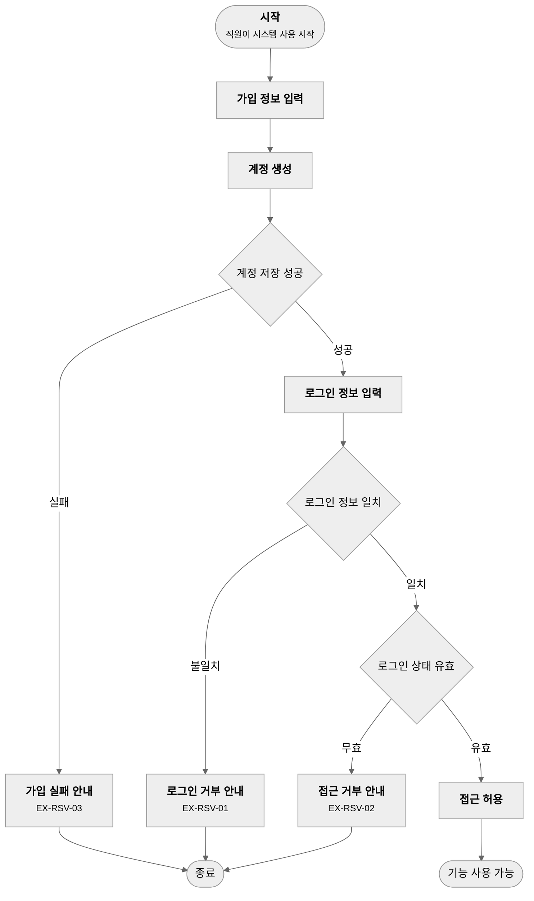
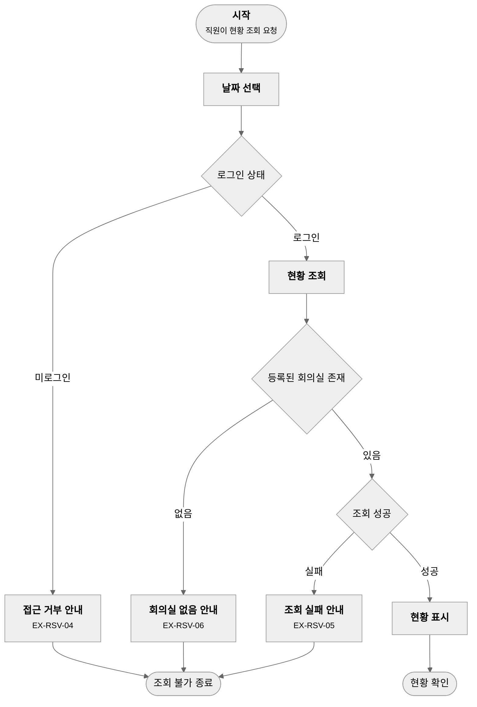
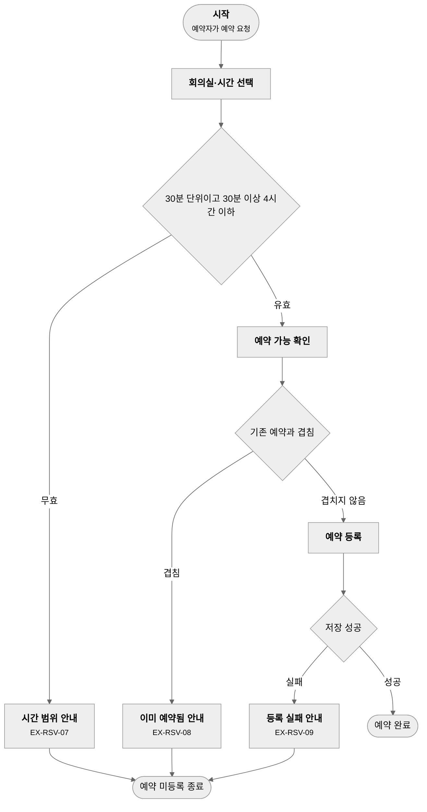
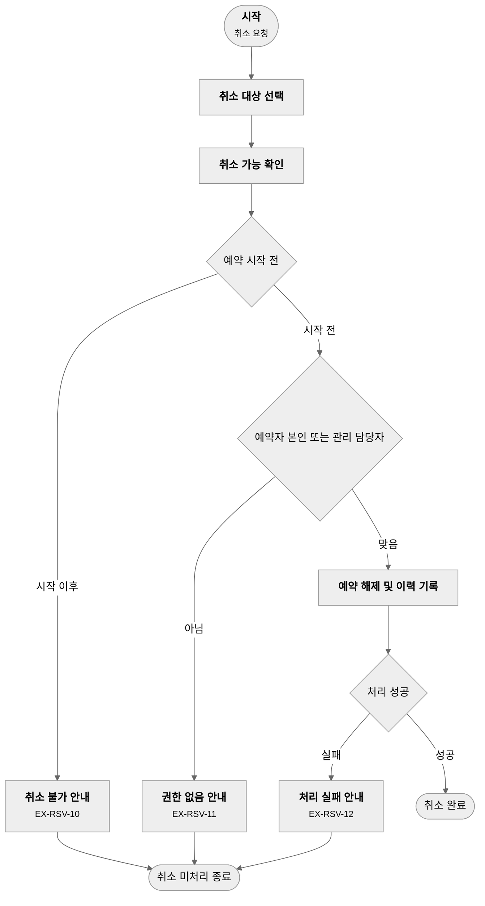
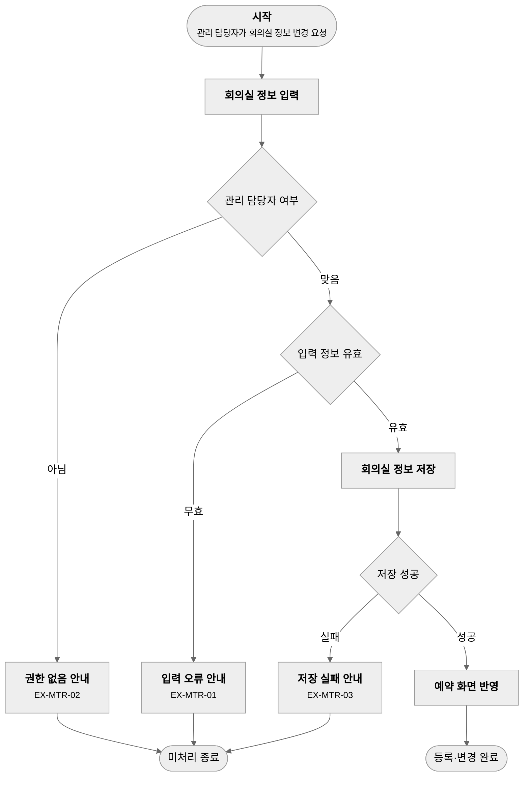
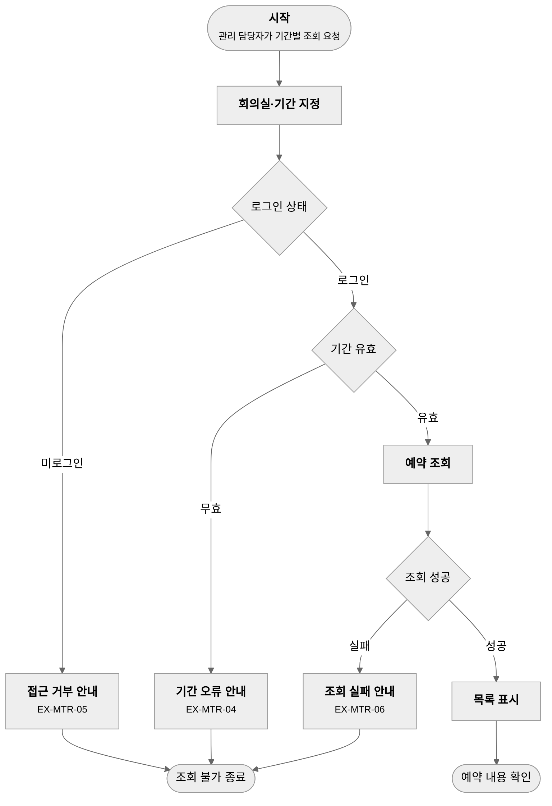

# 3-AN-09-O1 업무프로세스 정의서

## 1. 문서 정보

| 항목 | 내용 |
|------|------|
| 프로젝트명 | 회의실 예약 시스템 |
| 작성자 | 설동혁 (BA) |
| 작성일 | 2026-10-27 |
| 버전 | 1.0 |
| 비고 | 대체 입력 없음; 해당 없음: an-04(현행 업무 없음) |

## 2. 프로세스 목록

> `PROC-ID`의 영역코드는 도메인 분석표(`3-AN-05-O1`) §2에서 발급한 값이다(an-05 생략 시 「경량 수행」의 대체 발급 기준).

| PROC-ID | 프로세스명 | 영역 | 트리거 | 주요 참여 역할 | AS-IS 대비 |
|---------|----------|------|--------|---------------|----------|
| PROC-RSV-01 | 계정 가입·로그인 | 예약 | 직원이 시스템 사용을 시작 | 예약자 | 신규 |
| PROC-RSV-02 | 예약 현황 조회 | 예약 | 직원이 현황 조회를 요청 | 예약자, 회의실 관리 담당자 | 신규 |
| PROC-RSV-03 | 회의실 예약 | 예약 | 예약자가 예약을 요청 | 예약자 | 신규 |
| PROC-RSV-04 | 예약 취소 | 예약 | 예약자 또는 관리 담당자가 취소를 요청 | 예약자, 회의실 관리 담당자 | 신규 |
| PROC-MTR-01 | 회의실 등록·변경 | 회의실 | 관리 담당자가 회의실 정보 변경을 요청 | 회의실 관리 담당자 | 신규 |
| PROC-MTR-02 | 전체 예약 조회 | 회의실 | 관리 담당자가 기간별 조회를 요청 | 회의실 관리 담당자 | 신규 |

> `AS-IS 대비`는 `유지` / `개선` / `신규` 중 하나로 기재한다.
> `개선` · `신규` 항목은 아래 "AS-IS 대비 변경 사유"에 사유를 기록한다(품질 게이트 an-09.P6).

## 3. AS-IS 대비 변경 사유

| PROC-ID | AS-IS 대비 | 현행 흐름 | 변경 내용 | 변경 사유 | 근거 |
|---------|----------|----------|----------|----------|------|
| PROC-RSV-01 | 신규 | 해당 없음 — 신규구축 | 자체 계정 가입·로그인 도입 | 예약자 식별과 미인증 접근 차단 | REQ-F-001, REQ-NF-001 |
| PROC-RSV-02 | 신규 | 해당 없음 — 신규구축 | 회의실별·일시별 예약 현황 조회 도입 | 빈 회의실 확인 | REQ-F-002 |
| PROC-RSV-03 | 신규 | 해당 없음 — 신규구축 | 시간 단위 규칙·겹침 거부를 갖춘 예약 도입 | 이중 예약 방지 | REQ-F-003, REQ-F-004, BR-01 |
| PROC-RSV-04 | 신규 | 해당 없음 — 신규구축 | 시작 전 취소와 취소 이력 도입 | 일정 변경 대응 | REQ-F-005, REQ-F-006, BR-02 |
| PROC-MTR-01 | 신규 | 해당 없음 — 신규구축 | 회의실 정보 등록·변경 도입 | 회의실 정보 최신화 | REQ-F-007 |
| PROC-MTR-02 | 신규 | 해당 없음 — 신규구축 | 회의실·기간별 전체 예약 조회 도입 | 운영 현황 파악 | REQ-F-008, BR-03 |

> `유지` 프로세스는 이 표에 기재하지 않는다. `현행 흐름`은 an-04를 수행했으면 ASIS 분석 보고서(`3-AN-04-O1`) §5 업무 프로세스별 현행 흐름을 인용한다(품질 게이트 an-09.P6). 신규구축(an-04 해당 없음)이면 `현행 흐름`에
> 「해당 없음 — 신규구축」을 기재하고 `변경 사유`는 요구사항 근거로 작성한다.

## 4. 프로세스 상세

### PROC-RSV-01 계정 가입·로그인

**목적**: 직원이 계정을 만들고 로그인하여 예약 기능을 사용할 수 있게 한다.

**Actor**

| 구분 | 대상 |
|------|------|
| 사용자 | 예약자(직원) |
| 시스템 | 회의실 예약 시스템 |

**단계 정의**

> `관련` 열은 근거 `REQ-`를 필수로 적고, 그 요구사항이 스토리에서 나온 것이면 `US-`를 병기한다(품질 게이트 an-09.P2). `US-`가 없는 요구사항에 다른 스토리를 붙이지 않는다.

| 단계 | 활동 | 입력 | 출력 | 담당 | 관련 |
|------|------|------|------|------|------|
| 1 | 가입 정보 입력 | 계정 정보 | 가입 요청 | 예약자 | REQ-F-001, US-08, TERM-005 |
| 2 | 계정 생성 | 가입 요청 | 계정 | 시스템 | REQ-F-001, US-08, ENT-03 |
| 3 | 로그인 정보 입력 | 계정 정보 | 로그인 요청 | 예약자 | REQ-F-001, US-08 |
| 4 | 접근 허용 | 로그인 요청 | 로그인 상태 | 시스템 | REQ-F-001, REQ-NF-001, US-08 |

**프로세스 다이어그램**

**Exception Flow**

| EX-ID | 발생 단계 | 예외 상황 (성격) | 시스템 응답 | 관련 |
|-------|----------|----------|------------|------|
| EX-RSV-01 | 3 | 잘못된 로그인 정보를 입력한다 (입력 오류) | 로그인을 거부하고 재입력을 안내한다 | REQ-F-001 |
| EX-RSV-02 | 4 | 로그인 상태가 유효하지 않은 채 기능을 요청한다 (권한) | 요청을 거부하고 로그인 화면으로 안내한다 | REQ-NF-001 |
| EX-RSV-03 | 2 | 계정 저장에 실패한다 (시스템 장애) | 가입을 롤백하고 재시도를 안내한다 | REQ-F-001 |

**관련 요구사항 / 스토리**: REQ-F-001, REQ-NF-001 / US-08

---

### PROC-RSV-02 예약 현황 조회

**목적**: 직원이 회의실별·일시별 예약 현황을 확인한다.

**Actor**

| 구분 | 대상 |
|------|------|
| 사용자 | 예약자, 회의실 관리 담당자 |
| 시스템 | 회의실 예약 시스템 |

**단계 정의**

| 단계 | 활동 | 입력 | 출력 | 담당 | 관련 |
|------|------|------|------|------|------|
| 1 | 날짜 선택 | 조회 날짜 | 조회 요청 | 예약자 | REQ-F-002, US-01, TERM-004 |
| 2 | 현황 조회 | 조회 요청 | 회의실별 예약 정보 | 시스템 | REQ-F-002, REQ-NF-001, US-01, ENT-02 |
| 3 | 현황 표시 | 예약 정보 | 시간대별 예약 여부·예약자(회의 제목은 예약자·관리 담당자만) | 시스템 | REQ-F-002, US-01, BR-03 |

**프로세스 다이어그램**

**Exception Flow**

| EX-ID | 발생 단계 | 예외 상황 (성격) | 시스템 응답 | 관련 |
|-------|----------|----------|------------|------|
| EX-RSV-04 | 2 | 로그인하지 않은 사용자가 현황을 요청한다 (권한) | 요청을 거부하고 로그인 화면으로 안내한다 | REQ-NF-001, REQ-F-002 |
| EX-RSV-05 | 2 | 현황 조회에 실패한다 (시스템 장애) | 오류를 안내하고 재시도를 유도한다 | REQ-F-002 |
| EX-RSV-06 | 2 | 등록된 회의실이 없다 (기준 데이터 결손) | 등록된 회의실이 없음을 안내한다 | REQ-F-002, REQ-F-007 |

**관련 요구사항 / 스토리**: REQ-F-002, REQ-NF-001 / US-01

---

### PROC-RSV-03 회의실 예약

**목적**: 예약자가 회의실과 시간을 선택해 겹치지 않는 예약을 등록한다.

**Actor**

| 구분 | 대상 |
|------|------|
| 사용자 | 예약자 |
| 시스템 | 회의실 예약 시스템 |

**단계 정의**

| 단계 | 활동 | 입력 | 출력 | 담당 | 관련 |
|------|------|------|------|------|------|
| 1 | 회의실·시간 선택 | 회의실, 시작·종료 시각 | 예약 요청 | 예약자 | REQ-F-003, US-02, TERM-002 |
| 2 | 예약 가능 확인 | 예약 요청 | 가능 여부 | 시스템 | REQ-F-004, US-03, BR-01 |
| 3 | 예약 등록 | 예약 요청 | 예약 | 시스템 | REQ-F-003, US-02, ENT-02 |

**프로세스 다이어그램**

**Exception Flow**

| EX-ID | 발생 단계 | 예외 상황 (성격) | 시스템 응답 | 관련 |
|-------|----------|----------|------------|------|
| EX-RSV-07 | 1 | 시간이 30분 단위가 아니거나 30분 미만·4시간 초과이다 (입력 오류) | 예약을 거부하고 허용 범위를 안내한다 | REQ-F-003 |
| EX-RSV-08 | 2 | 선택한 시간이 기존 예약과 일부라도 겹친다 (업무 규칙 위반) | 예약을 거부하고 "이미 예약됨"을 안내한다. 기존 예약은 바뀌지 않는다 | REQ-F-004, BR-01 |
| EX-RSV-09 | 3 | 예약 저장에 실패한다 (시스템 장애) | 등록을 롤백하고 재시도를 안내한다 | REQ-F-003 |

**관련 요구사항 / 스토리**: REQ-F-003, REQ-F-004 / US-02, US-03

---

### PROC-RSV-04 예약 취소

**목적**: 예약자 또는 회의실 관리 담당자가 시작 전 예약을 취소하고 이력을 남긴다.

**Actor**

| 구분 | 대상 |
|------|------|
| 사용자 | 예약자, 회의실 관리 담당자 |
| 시스템 | 회의실 예약 시스템 |

**단계 정의**

| 단계 | 활동 | 입력 | 출력 | 담당 | 관련 |
|------|------|------|------|------|------|
| 1 | 취소 대상 선택 | 예약 | 취소 요청 | 예약자, 회의실 관리 담당자 | REQ-F-005, US-04, TERM-003 |
| 2 | 취소 가능 확인 | 취소 요청 | 가능 여부 | 시스템 | REQ-F-005, REQ-F-006, US-04, US-05, BR-02 |
| 3 | 예약 해제 및 이력 기록 | 취소 요청 | 해제된 예약, 취소 이력 | 시스템 | REQ-F-005, US-04, ENT-02 |

**프로세스 다이어그램**

**Exception Flow**

| EX-ID | 발생 단계 | 예외 상황 (성격) | 시스템 응답 | 관련 |
|-------|----------|----------|------------|------|
| EX-RSV-10 | 2 | 예약 시작 이후에 취소를 요청한다 (상태 전이) | 취소를 거부하고 시작 이후에는 취소할 수 없음을 안내한다 | REQ-F-005, BR-02 |
| EX-RSV-11 | 2 | 예약자 본인도 관리 담당자도 아닌 사용자가 취소를 요청한다 (권한) | 취소를 거부하고 권한 없음을 안내한다 | REQ-F-006, BR-02 |
| EX-RSV-12 | 3 | 예약 해제 또는 이력 저장에 실패한다 (시스템 장애) | 처리를 롤백하고 재시도를 안내한다 | REQ-F-005 |

**관련 요구사항 / 스토리**: REQ-F-005, REQ-F-006 / US-04, US-05

---

### PROC-MTR-01 회의실 등록·변경

**목적**: 회의실 관리 담당자가 회의실 정보를 등록하고 변경한다.

**Actor**

| 구분 | 대상 |
|------|------|
| 사용자 | 회의실 관리 담당자 |
| 시스템 | 회의실 예약 시스템 |

**단계 정의**

| 단계 | 활동 | 입력 | 출력 | 담당 | 관련 |
|------|------|------|------|------|------|
| 1 | 회의실 정보 입력 | 회의실명, 위치, 수용 인원, 비치 장비 | 등록·변경 요청 | 회의실 관리 담당자 | REQ-F-007, US-06, TERM-001, ENT-01 |
| 2 | 회의실 정보 저장 | 등록·변경 요청 | 회의실 정보 | 시스템 | REQ-F-007, US-06, ENT-01 |
| 3 | 예약 화면 반영 | 회의실 정보 | 갱신된 예약 화면 | 시스템 | REQ-F-007, US-06 |

**프로세스 다이어그램**

**Exception Flow**

| EX-ID | 발생 단계 | 예외 상황 (성격) | 시스템 응답 | 관련 |
|-------|----------|----------|------------|------|
| EX-MTR-01 | 1 | 회의실 정보가 입력되지 않았거나 형식에 맞지 않는다 (입력 오류) | 등록·변경을 거부하고 입력 항목을 안내한다 | REQ-F-007 |
| EX-MTR-02 | 1 | 관리 담당자가 아닌 사용자가 등록·변경을 요청한다 (권한) | 요청을 거부하고 권한 없음을 안내한다 | REQ-F-007 |
| EX-MTR-03 | 2 | 회의실 정보 저장에 실패한다 (시스템 장애) | 저장을 롤백하고 재시도를 안내한다 | REQ-F-007 |

**관련 요구사항 / 스토리**: REQ-F-007 / US-06

---

### PROC-MTR-02 전체 예약 조회

**목적**: 회의실 관리 담당자가 회의실과 기간별 전체 예약 내용을 조회한다.

**Actor**

| 구분 | 대상 |
|------|------|
| 사용자 | 회의실 관리 담당자 |
| 시스템 | 회의실 예약 시스템 |

**단계 정의**

| 단계 | 활동 | 입력 | 출력 | 담당 | 관련 |
|------|------|------|------|------|------|
| 1 | 회의실·기간 지정 | 회의실, 기간 | 조회 요청 | 회의실 관리 담당자 | REQ-F-008, US-07, TERM-006 |
| 2 | 예약 조회 | 조회 요청 | 예약 목록 | 시스템 | REQ-F-008, US-07, BR-03 |
| 3 | 목록 표시 | 예약 목록 | 예약 내용(시간·예약자·회의 제목), 취소된 예약 제외 | 시스템 | REQ-F-008, US-07 |

**프로세스 다이어그램**

**Exception Flow**

| EX-ID | 발생 단계 | 예외 상황 (성격) | 시스템 응답 | 관련 |
|-------|----------|----------|------------|------|
| EX-MTR-04 | 1 | 지정한 기간의 시작이 종료보다 늦다 (입력 오류) | 조회를 거부하고 기간 재지정을 안내한다 | REQ-F-008 |
| EX-MTR-05 | 1 | 로그인하지 않은 사용자가 조회를 요청한다 (권한) | 요청을 거부하고 로그인 화면으로 안내한다 | REQ-NF-001, REQ-F-008 |
| EX-MTR-06 | 2 | 예약 조회에 실패한다 (시스템 장애) | 오류를 안내하고 재시도를 유도한다 | REQ-F-008 |

**관련 요구사항 / 스토리**: REQ-F-008 / US-07

## 5. 추적성 매핑

| PROC-ID | 관련 요구사항 | 관련 스토리 | 관련 엔터티 |
|---------|--------------|-----------|-----------|
| PROC-RSV-01 | REQ-F-001, REQ-NF-001 | US-08 | ENT-03 |
| PROC-RSV-02 | REQ-F-002, REQ-NF-001 | US-01 | ENT-02 |
| PROC-RSV-03 | REQ-F-003, REQ-F-004 | US-02, US-03 | ENT-02 |
| PROC-RSV-04 | REQ-F-005, REQ-F-006 | US-04, US-05 | ENT-02 |
| PROC-MTR-01 | REQ-F-007 | US-06 | ENT-01 |
| PROC-MTR-02 | REQ-F-008 | US-07 | ENT-01, ENT-02 |

## 6. 변경 이력

| 버전 | 변경일 | 변경자 | 변경 내용 |
|------|--------|--------|---------|
| 1.0 | 2026-10-27 | 설동혁 (BA) | 최초 작성. 요구사항 정의서 REQ-F-001~008·REQ-NF-001에서 프로세스 6개 도출. 신규구축(an-04 해당 없음)이라 전 프로세스 AS-IS 대비 신규 |
