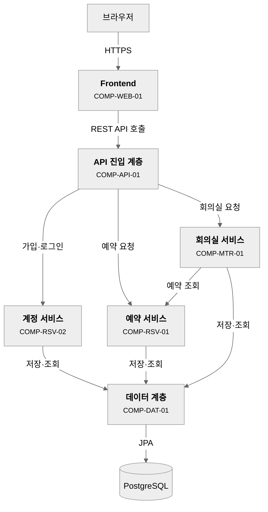

# 4-DN-01-O1 시스템 아키텍처 정의서

---

## 1. 문서 정보

| 항목 | 내용 |
|------|------|
| 프로젝트명 | 회의실 예약 시스템 |
| 작성자 | 설동혁 (AA) |
| 작성일 | 2026-10-27 |
| 버전 | 1.0 |
| 비고 | 위임 결정: 요구사항 정의서 호환성 위임 항목 없음; 기술 스택·배포·지원 범위는 PM 결정(설동혁 2026-10-27) |
| 편입 | — |

> 대행·복수 작성자 표기는 DOC-TEMPLATE(`9-CM-01`) 「산출물 문서 메타」를 따른다(예: `이PL (PL, AA 대행)`).

## 2. 아키텍처 개요

이 시스템은 하나의 배포 단위로 구성한 레이어드 아키텍처(모놀리식)를 채택한다. Next.js 웹 프론트엔드(`COMP-WEB-01`), Spring Boot 기반 REST API 진입 계층(`COMP-API-01`), 예약자 계정·예약·회의실 서비스(`COMP-RSV-02`·`COMP-RSV-01`·`COMP-MTR-01`), JPA 기반 데이터 계층(`COMP-DAT-01`)과 PostgreSQL로 이뤄진 7개 요소로 구성하며, 단일 서버에서 docker-compose로 배포한다. 요구사항이 정한 핵심 품질 목표는 로그인하지 않은 사용자의 접근 차단(`REQ-NF-001`)이고, 성능·가용성·확장성 목표는 요구사항에 없어 미확인이다.

---

## 3. ADR (아키텍처 결정 기록)

> **상태 값**: `제안됨` · `승인됨` · `폐기됨`(→ 새 ADR) · `부분 대체됨 — <대체된 갈래> → ADR-nn`(여러 갈래를 묶은 ADR의 일부만 번복했을 때, 나머지 갈래는 유효). 기존 ADR은 덮어쓰지 않는다(시스템 아키텍처 설계(`4-DN-01`) 주의사항).

### ADR-01 아키텍처 스타일 선택

| 항목          | 내용                                                 |
| ----------- | -------------------------------------------------- |
| 상태          | 승인됨                                                |
| 맥락          | 소규모 내부 도구이고 1인 프로젝트이며, 요구사항에 기능 모듈 간 독립 배포·대규모 트래픽 요구가 없다. 이용 인원 규모는 미정(Q-CMM-01) |
| 결정 사항       | 레이어드 아키텍처(단일 배포 단위, 모놀리식) 채택. 백엔드는 API 계층 → 서비스 계층 → 데이터 계층으로 나눈다 |
| 기각된 대안      | MSA — 1인 프로젝트와 소규모 기능에 비해 운영 복잡도가 과도하다 |
| 결과 및 트레이드오프 | 구조가 단순하고 개발·배포가 쉽다. 이용 규모가 크게 늘면 서비스 분리 비용이 든다 |
| 관련 요구사항 ID  | REQ-F-001~REQ-F-008, REQ-NF-001 |
| 조건의 집행 활동 | — |

### ADR-02 VCS 브랜치 모델

| 항목 | 내용 |
|------|------|
| 상태 | 승인됨 |
| 맥락 | 1인 프로젝트이고 QA 전담이 없다. `config.yaml`의 `vcs.branch_model`이 이미 `"A"`로 설정돼 있다 |
| 결정 사항 | 모델 A (GitHub Flow, `main`만 사용) — `config.yaml` `vcs.branch_model: "A"` (9-CM-03) |
| 기각된 대안 | 모델 B — 통합 브랜치(dev) 유지 비용 대비 이득이 없다 |
| 결과 및 트레이드오프 | 구조가 단순하다. 릴리즈 동결이 필요해지면 B로 전환(ADR 개정) |
| 관련 요구사항 ID | — |
| 조건의 집행 활동 | — |

### ADR-03 프론트엔드 구조

| 항목 | 내용 |
|------|------|
| 상태 | 승인됨 |
| 맥락 | 직원이 웹 브라우저로 예약 현황을 조회하고 예약·취소한다. 지원 범위는 PM이 정했다(설동혁 2026-10-27) |
| 결정 사항 | Next.js (App Router) + React + TypeScript 웹 애플리케이션 1개. 최신 Chrome·Edge·Safari 데스크톱을 주 대상으로 하고 모바일 웹은 반응형으로 최소 동작만 보장한다. 모바일 앱은 제외한다 |
| 기각된 대안 | 데스크톱 웹 전용 — 이후 모바일 지원을 추가하기 어렵다 / React + Vite SPA — 5-IM-01 기본 프리셋에서 벗어나 스캐폴딩 결정이 늘어난다 |
| 결과 및 트레이드오프 | 기본 프리셋을 따라 추가 결정이 적다. 모바일 화면 품질은 최소 수준이다 |
| 관련 요구사항 ID | REQ-F-002, REQ-F-003 |
| 조건의 집행 활동 | — |

### ADR-04 인증 방식

| 항목 | 내용 |
|------|------|
| 상태 | 승인됨 |
| 맥락 | 예약자 식별과 미로그인 접근 차단이 필요하다(REQ-F-001, REQ-NF-001). 사내 계정 연동은 이번 범위에서 제외했다(Q-RSV-05 PM 결정) |
| 결정 사항 | 자체 계정(가입·로그인)을 두고 모든 API 요청을 인증 필터(`COMP-API-01`)에서 로그인 상태로 검사한다. 상세한 세션·토큰 방식은 개발환경 세팅(5-IM-01)·공통 기능 구현(5-IM-04)에서 정한다 |
| 기각된 대안 | 사내 계정(SSO) 연동 — 연동 대상 시스템이 정해지지 않았고 범위에서 제외했다 |
| 결과 및 트레이드오프 | 연동 의존이 없어 단순하다. 계정 관리 기능(가입·로그인)을 직접 구현해야 하고 개요서 범위(SCP-01·02)에 인증이 명시돼 있지 않다 |
| 관련 요구사항 ID | REQ-F-001, REQ-NF-001 |
| 조건의 집행 활동 | — |

### ADR-05 기술 스택 및 데이터 접근

| 항목 | 내용 |
|------|------|
| 상태 | 승인됨 |
| 맥락 | 개요서 §6이 사용 가능 기술을 Java / Spring Boot, React, PostgreSQL로 정했고 공통 프레임워크는 `none`이다. 소프트웨어 아키텍처 정의(4-DN-03)를 생략해 이 문서가 기술 스택을 담는다 |
| 결정 사항 | 백엔드는 Spring Boot, 데이터 접근은 JPA, 데이터베이스는 PostgreSQL. 프론트엔드 상태 관리·서버 상태·HTTP·스키마 검증·스타일링·디자인 시스템은 사내 표준 기본값을 그대로 채택한다(§8.1) |
| 기각된 대안 | SQL 매퍼 — 기존 SQL 승계가 없는 신규 프로젝트에서 이점이 작다 |
| 결과 및 트레이드오프 | 엔티티 명세(`entities.yaml`)와 엔티티 코드가 직접 대응한다. 복잡한 조회는 JPA 쿼리 방법을 따로 정해야 할 수 있다 |
| 관련 요구사항 ID | REQ-F-001~REQ-F-008 |
| 조건의 집행 활동 | — |

### ADR-06 배포 방식

| 항목 | 내용 |
|------|------|
| 상태 | 승인됨 |
| 맥락 | 소규모 내부 도구이며 시스템 구성도(4-DN-02)를 생략했다. 운영 서버 유형(온프레미스·클라우드)은 정해지지 않았다 |
| 결정 사항 | 단일 서버에서 docker-compose로 web·api·db 서비스를 함께 기동한다. 운영 서버 유형은 배포 계획 수립(7-DP-01)에서 확정한다 |
| 기각된 대안 | 퍼블릭 클라우드 관리형 서비스 — 종류·비용·지역을 지금 정해야 하고 근거가 없다 |
| 결과 및 트레이드오프 | 구성이 단순하다. 단일 서버라 가용성은 서버 한 대에 의존한다(가용성 목표는 요구사항에 없음) |
| 관련 요구사항 ID | — |
| 조건의 집행 활동 | — |

---

## 4. 컴포넌트 목록

| 컴포넌트 ID     | 컴포넌트명            | 책임                       | 제공 인터페이스         | 의존 컴포넌트     | 관련 요구사항 ID                | 관련 프로세스 ID   |
| ----------- | ---------------- | ------------------------ | ---------------- | ----------- | ------------------------- | ------------ |
| COMP-WEB-01 | Frontend         | 직원이 쓰는 웹 화면을 제공하고 사용자 요청을 API로 전달한다 | HTTP/HTTPS | COMP-API-01 | REQ-F-001, REQ-F-002, REQ-F-003, REQ-F-005, REQ-F-007, REQ-F-008, REQ-NF-001 | PROC-RSV-01, PROC-RSV-02, PROC-RSV-03, PROC-RSV-04, PROC-MTR-01, PROC-MTR-02 |
| COMP-API-01 | API 진입 계층        | 요청을 서비스로 연결하고 로그인하지 않은 요청을 거부한다 | REST API | COMP-RSV-02, COMP-RSV-01, COMP-MTR-01 | REQ-F-001, REQ-F-006, REQ-NF-001 | PROC-RSV-01, PROC-RSV-02, PROC-RSV-03, PROC-RSV-04, PROC-MTR-01, PROC-MTR-02 |
| COMP-RSV-02 | 계정 서비스          | 예약자 계정의 가입과 로그인을 처리한다 | 내부 서비스 인터페이스 | COMP-DAT-01 | REQ-F-001 | PROC-RSV-01 |
| COMP-RSV-01 | 예약 서비스          | 예약 현황 조회, 예약 등록(겹침 거부 포함), 예약 취소와 이력을 처리한다 | 내부 서비스 인터페이스 | COMP-DAT-01 | REQ-F-002, REQ-F-003, REQ-F-004, REQ-F-005, REQ-F-006 | PROC-RSV-02, PROC-RSV-03, PROC-RSV-04 |
| COMP-MTR-01 | 회의실 서비스         | 회의실 정보를 등록·변경하고 회의실·기간별 전체 예약을 조회한다 | 내부 서비스 인터페이스 | COMP-RSV-01, COMP-DAT-01 | REQ-F-007, REQ-F-008 | PROC-MTR-01, PROC-MTR-02 |
| COMP-DAT-01 | 데이터 계층          | 계정·예약·회의실·취소 이력의 영속성을 JPA로 관리한다 | Repository 인터페이스 | — | REQ-F-001~REQ-F-008 | — |

---

## 5. 컴포넌트 관계 다이어그램

> **표기 규칙** — 동기 호출(요청-응답)은 실선 화살표(`-->`)로, 도메인 이벤트(발행→구독)는 점선 화살표(`-.->`)로 구분하고 라벨은 `event: {이름}` 접두로 쓴다(`9-CM-04` 「점선 = 조건부·선택적 흐름」과 구분). 도메인 이벤트 목록은 도메인 정의서(`4-DN-11-O1`) §7 도메인 이벤트 표, 규약은 공통 개발규칙(`4-DN-21-O3`) 「도메인 이벤트 규약」이 정본이며, 이 다이어그램은 발행-구독 관계만 시각화한다. 이 시스템은 도메인 이벤트가 없다.

---

## 6. 품질 속성별 달성 전략

| 품질 속성 | 목표 수치 / 수용 기준 | 달성 전략 | 관련 요구사항 | 관련 ADR |
|----------|----------------------|----------|-------------|---------|
| 보안(접근 제어) | 로그인하지 않은 상태의 모든 요청이 거부되고 로그인 화면으로 안내된다 | API 진입 계층의 인증 필터가 모든 요청의 로그인 상태를 검사하고, 프론트엔드가 미로그인 시 로그인 화면으로 이동시킨다 | REQ-NF-001 | ADR-04 |
| 성능·가용성·확장성 | 미확인 — 확인 필요(요구사항에 목표 수치 없음, 이용 인원 규모 미정 Q-CMM-01) | 미확인 — 확인 필요(목표가 정해지면 추가) | — | ADR-01, ADR-06 |

---

## 7. 요구사항-컴포넌트 추적 매트릭스

> 요구사항 정의서에서 `구분`이 `기능`인 요구사항을 **전수** 싣는다(품질 게이트 dn-01.P5는 이 표에서 `우선순위`가 `Must`인 행을 판정한다). `우선순위`는 요구사항 정의서의 값(Must/Should/Could)을 그대로 옮긴다. 비기능 요구사항은 §6이 다루며, 특정 컴포넌트에 할당되는 것만 이 표에 함께 적는다.

| 요구사항 ID | 우선순위 | 요구사항 내용 (요약) | 할당 컴포넌트 ID |
|------------|------|-------------------|-----------------|
| REQ-F-001 | Must | 직원이 계정을 만들어 로그인 | COMP-WEB-01, COMP-API-01, COMP-RSV-02, COMP-DAT-01 |
| REQ-F-002 | Must | 회의실별·일시별 예약 현황 조회 | COMP-WEB-01, COMP-API-01, COMP-RSV-01, COMP-DAT-01 |
| REQ-F-003 | Must | 회의실·시간 선택 예약(30분 단위, 최소 30분·최대 4시간) | COMP-WEB-01, COMP-API-01, COMP-RSV-01, COMP-DAT-01 |
| REQ-F-004 | Must | 겹치는 예약 거부 | COMP-RSV-01, COMP-DAT-01 |
| REQ-F-005 | Must | 시작 전 본인 예약 취소와 이력 | COMP-WEB-01, COMP-API-01, COMP-RSV-01, COMP-DAT-01 |
| REQ-F-006 | Should | 관리 담당자의 타인 예약 취소 | COMP-API-01, COMP-RSV-01 |
| REQ-F-007 | Must | 관리 담당자의 회의실 등록·변경 | COMP-WEB-01, COMP-API-01, COMP-MTR-01, COMP-DAT-01 |
| REQ-F-008 | Should | 회의실·기간별 전체 예약 조회 | COMP-WEB-01, COMP-API-01, COMP-MTR-01, COMP-RSV-01, COMP-DAT-01 |
| REQ-NF-001 | Must | 로그인하지 않은 사용자의 접근 차단 | COMP-WEB-01, COMP-API-01 |

---

## 8. 배포 환경 요약

> **[작성 안내]** 이 섹션은 조건부다 — 시스템 구성도 작성(4-DN-02, 시스템 구성도)을 생략한 경우에만 작성한다. 시스템 구성도 작성(4-DN-02)은 시스템 아키텍처 설계(4-DN-01) 이후 활동이므로, 시스템 아키텍처 설계(4-DN-01) 작성(AI 초안 포함) 시점에는 생략 여부가 아직 미정일 수 있다. **생략이 `skip_stages`에 이미 선등록되어 있으면 그 사실만으로 확정이므로 작성 시점에 바로 채운다.** 아직 미정이면 비워 두고, 이후 시스템 구성도 작성(4-DN-02) 생략이 확정된 경우에만 채운다. 시스템 구성도 작성(4-DN-02)이 산출되었다면 비워 두거나 삭제한다. ('모든 섹션을 채운다' 지시의 대상이 아니다.)

| 항목 | 내용 |
|------|------|
| 생략 사유 | SI 납품·온프레미스·망 분리 요건이 없는 소규모 내부 도구라 인프라 구성도를 따로 설계할 필요가 없다(RSK-08) |
| 배포 환경 유형 | 미확인 — 확인 필요(단일 서버 docker-compose로 정함. 온프레미스·클라우드 유형은 배포 계획 수립 7-DP-01에서 확정) |
| 컴포넌트-서버 매핑 요약 | 아래 표 참조 |

| 컴포넌트 ID | 컴포넌트명 | 배포 대상 |
|------------|-----------|----------|
| COMP-WEB-01 | Frontend | 단일 서버의 web 서비스(컨테이너) |
| COMP-API-01 | API 진입 계층 | 단일 서버의 api 서비스(컨테이너) |
| COMP-RSV-02, COMP-RSV-01, COMP-MTR-01 | 계정·예약·회의실 서비스 | 단일 서버의 api 서비스(컨테이너) — 같은 애플리케이션 |
| COMP-DAT-01 | 데이터 계층 | 단일 서버의 api 서비스(컨테이너) — 같은 애플리케이션. 데이터는 db 서비스(PostgreSQL) |

**배포 구성** — 시스템 구성도 작성(`4-DN-02`) 대체 입력 요건(리스크 대장 등재 항목의 근거 자료)을 담는다. 컴포넌트-서버 매핑보다 세부 수준(compose 서비스·포트·볼륨·네트워크·환경 분리)이다.

| 항목 | 내용 |
|------|------|
| 서비스 | web, api, db (compose 서비스명) |
| 포트 | web:3000, api:8080, db:5432 (제안 — 개발환경 세팅 5-IM-01에서 확정) |
| 볼륨 | db-data:/var/lib/postgresql/data |
| 네트워크 | 단일 bridge 네트워크 |
| 환경 분리 | 미확인 — 확인 필요(개발/운영 설정 분리 방식은 CI/CD 파이프라인 구성 5-IM-02·운영 환경 구성 7-DP-02에서 확정) |

### 8.1 기술 스택 (4-DN-03 생략 시)

> **[작성 안내]** 이 절은 조건부다 — 소프트웨어 아키텍처 정의서 작성(4-DN-03, 소프트웨어 아키텍처 정의서)을 생략한 경우에만 작성한다. **생략이 `skip_stages`에 이미 선등록되어 있으면 그 사실만으로 확정이므로 작성 시점에 바로 채운다.** 아직 미정이면 §8과 같은 이유로 비워 두고, 생략이 확정된 뒤 채운다. 소프트웨어 아키텍처 정의서 작성(4-DN-03)을 수행했다면 비워 두거나 삭제한다.
> 열은 소프트웨어 아키텍처 정의서(`4-DN-03-O1`) §2와 같다. **「데이터 접근」 행·Frontend 역량 행은 생략할 수 없다** — 하류(`4-DN-21-O3`·개발환경 세팅(`5-IM-01`)·코딩 컨벤션 규칙 작성(`5-IM-05`)·엔티티 코드 구현(`5-IM-06`)·Backend 초안 작성(`5-IM-21`)~Backend 코드 구현(`5-IM-24`))가 「4-DN-03-O1 §2」로 참조하는 곳은 이 절을 읽는다. 데이터 접근 값은 `JPA` 또는 `SQL 매퍼`이고 영역별로 갈리면 행을 나눈다(`4-DN-00` 「선택 활동 생략 시 산출물 처리」). Frontend 역량 행은 사내 표준 기본값(React Query·Axios·Zustand·Zod·Tailwind CSS·shadcn/ui)을 특별한 사유 없으면 그대로 채택한다.

| 영역 | 기술명 | 버전 | 선택 근거 | 참조 ADR |
|------|--------|------|----------|---------|
| Frontend | Next.js (App Router) + React + TypeScript | 미확인 — 확인 필요(5-IM-01에서 확정) | 5-IM-01 기본 프리셋 | ADR-03 |
| Frontend 상태 관리 | Zustand | 미확인 — 확인 필요(5-IM-01에서 확정) | 사내 표준 기본값 채택 | ADR-03 |
| Frontend 서버 상태 관리·캐싱 | TanStack React Query | 미확인 — 확인 필요(5-IM-01에서 확정) | 사내 표준 기본값 채택 | ADR-03 |
| Frontend HTTP 클라이언트 | Axios | 미확인 — 확인 필요(5-IM-01에서 확정) | 사내 표준 기본값 채택 | ADR-03 |
| Frontend 스키마 검증 | Zod | 미확인 — 확인 필요(5-IM-01에서 확정) | 사내 표준 기본값 채택 | ADR-03 |
| Frontend 스타일링 | Tailwind CSS | 미확인 — 확인 필요(5-IM-01에서 확정) | 사내 표준 기본값 채택 | ADR-03 |
| Frontend 디자인 시스템 | shadcn/ui | — | 사내 표준 기본값 채택 | ADR-03 |
| Backend | Java / Spring Boot | 미확인 — 확인 필요(5-IM-01에서 확정) | 개요서 §6 사용 가능 기술 | ADR-05 |
| **데이터 접근** | JPA | — | PM 결정(설동혁 2026-10-27) — 신규 프로젝트로 기존 SQL 승계 없음 | ADR-05 |
| Database | PostgreSQL | 미확인 — 확인 필요(5-IM-01에서 확정) | 개요서 §6 사용 가능 기술 | ADR-05 |

**공통 모듈 목록** — 소프트웨어 아키텍처 정의서(`4-DN-03-O1`) §4와 같은 열(「도메인에 요구하는 계약(포트)」 포함). 「제공 주체」가 제품 기능 구현(`5-IM-03`, 제품 제공)과 공통 기능 구현(`5-IM-04`, 프로젝트 구현)의 경계이므로 이 표도 생략할 수 없다.

| 모듈명 | 책임 | 제공 인터페이스 | 제공 주체 | 도메인에 요구하는 계약(포트) | 적용 대상 컴포넌트 |
|--------|------|----------------|:--------:|-----------------------------|-----------------|
| AuthFilter | 요청의 로그인 상태를 검사하고 미로그인 요청을 거부한다 | HTTP 필터 | 프로젝트 구현 | 현재 로그인 사용자 식별(계정 서비스가 제공) | COMP-API-01 |
| 공통 예외 처리·응답 포맷 (추정 — 확인 필요) | 오류를 일관된 응답으로 변환한다 | 전역 예외 핸들러 | 프로젝트 구현 | — (해당 없음) | COMP-API-01 |
| 공통 로깅 (추정 — 확인 필요) | 요청과 오류를 기록한다 | 로깅 설정 | 프로젝트 구현 | — (해당 없음) | COMP-API-01 |

---

## 9. 생략 활동 기록

> **[작성 안내]** 4-DN의 조건부·선택 활동(`4-DN-02`·`03`·`11`·`13`·`22`)을 생략할 때 여기에 모아 적는다(`4-DN-00` 「생략 기록 원칙」, 실현 원칙 12). 작성 시점에는 비워 두고 생략이 확정될 때마다 행을 추가한다 — 생략한 단계가 없으면 「없음」 한 줄로 둔다. `리스크 대장`은 수행계획서(`2-MG-01-O1`) §6에 등재한 항목 ID(`RSK-NN`)이고, §6이 없는 프로젝트는 WBS(`2-MG-02-O1`) 문서 정보 비고에 등재하고 이 표 `비고`에 병기한다. 생략의 대체 내용은 §8(4-DN-02)·§8.1(4-DN-03)·`entities.yaml`(4-DN-11)·프로그램 목록(`4-DN-21-O1`) §2 각주(4-DN-22)에 있다.

| 활동 | 생략 사유 | PM 확인 | 리스크 대장 | 비고 |
|------|---------|--------|-----------|------|
| 4-DN-02 | SI 납품·온프레미스·망 분리 요건이 없는 소규모 내부 도구 | 설동혁 2026-10-27 | RSK-08 | 지목하는 하류 게이트 없음. 대체: §8 |
| 4-DN-03 | 소규모 단일 스택 — 기술 스택을 §8.1로 흡수 | 설동혁 2026-10-27 | RSK-09 | 하류 게이트가 생략 시 §8.1을 읽도록 명시: im-01.P4·P12, im-03.P1, im-04.P1·P3, im-05.P2·P4·P5, im-06.P3·B2, im-21.P2, im-22.B2, im-23.P6, im-24.P1·P6, dp-02.P2, dn-21.P7·P10, dn-33.P4. 대체: §8.1 |
| 4-DN-11 | 엔티티 3개·도메인 2개 — `entities.yaml`로 흡수 | 설동혁 2026-10-27 | RSK-10 | 하류 게이트가 생략 시 `entities.yaml`·도메인 분석표를 읽도록 명시: dn-12.P1·P3·P5, dn-14.P2·P3·P5·P7, dn-36.P4. 대체: `entities.yaml` |
| 4-DN-13 | 도메인이 단순해 클래스 구조 기록 불필요 | 설동혁 2026-10-27 | RSK-11 | 지목하는 하류 게이트 없음. 대체: `entities.yaml`의 `relations` |
| 4-DN-22 | 화면이 소수라 IA 정의 불필요 | 설동혁 2026-10-27 | RSK-12 | 지목하는 하류 게이트 없음. 대체: 프로그램 목록(`4-DN-21-O1`) §2 각주 |

---

## 10. 변경 이력

| 버전 | 변경일 | 변경자 | 변경 내용 |
|------|--------|--------|---------|
| 1.0 | 2026-10-27 | 설동혁 (AA) | 최초 작성. 요구사항 정의서·업무프로세스 정의서와 PM 결정(데이터 접근 JPA, Next.js, 단일 서버 docker-compose, 데스크톱 중심 반응형)에서 도출 |
