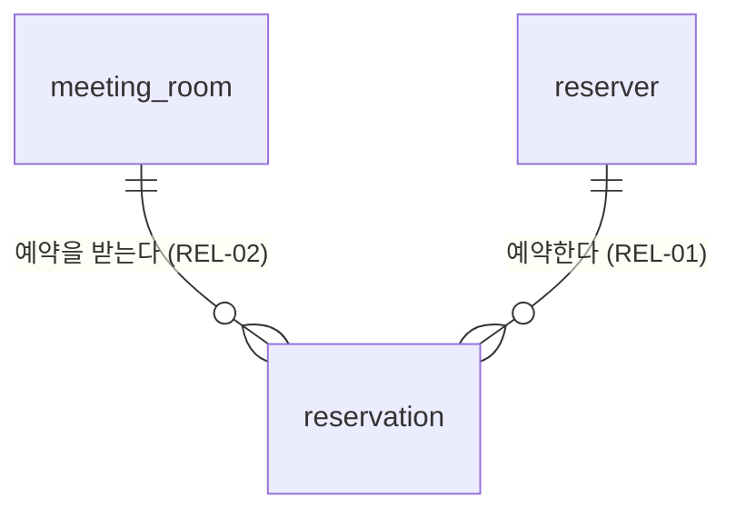

# 4-DN-14-O1 ERD-overview

전체 엔티티 관계 조감 ERD. 컬럼 없이 엔티티 이름과 카디널리티만 표시한다.
도메인별 상세 ERD는 `4-DN-14-O2 ERD-{domainId}.md` 를 참조한다.

---

## 1. 문서 정보

| 항목 | 내용 |
|------|------|
| 프로젝트명 | 회의실 예약 시스템 |
| 작성자 | 설동혁 (DA) |
| 작성일 | 2026-10-27 |
| 버전 | 1.0 |
| 전략 | Code First — 코드 전 — 선택 근거: 신규 서비스이고 데이터 접근이 JPA(ADR-05)라 `entities.yaml`에서 ERD를 먼저 도출·확정한다(PM 결정 설동혁 2026-10-27) |
| 물리 스키마 적용 방법 | 마이그레이션 도구 (Flyway) — 선택 근거: 운영 배포용 기본 권장, `ddl-auto`는 `validate`로 고정(PM 결정 설동혁 2026-10-27) |
| 감사 컬럼 물리 정본 | 타입: 일시 `timestamp`·주체 `bigint` · NULL: 일시 NOT NULL·주체 NULL 허용 · FK: 없음 · 상속 방식: 공통 부모 클래스(BaseEntity) 상속 — 4컬럼 `created_at`·`updated_at`·`created_by`·`updated_by`. §5 구조 변환 규칙은 해당 없음이라 충돌 없음 |
| DB 로케일·콜레이션 | PostgreSQL — UTF-8 인코딩, 한글 정렬 콜레이션 사용. 세부 설정은 미확인 — 확인 필요(개발환경 세팅 5-IM-01에서 확정) — 정렬(ORDER BY)·대소문자 비교 계약의 근거 |
| 시드 적용 범위 | 해당 없음 — 기준 데이터(공통 코드 등) 시드 대상이 없다(PM 결정 설동혁 2026-10-27). 필요가 생기면 개정한다 |
| 참조 | `3-AN-05-O1 도메인 분석표.md` (ENT-01~ENT-03, REL-01, REL-02) · `4-DN-12-O2` `entities.yaml` (4-DN-11 생략) |

> **[작성 안내]** 「시드 적용 범위」— 전 프로파일 시드는 통합 테스트가 특정 데이터 건수를 단언하는
> 경우와 충돌할 수 있다(예: 시드가 만든 수신자·건수가 통합 테스트의 기대 건수에 섞인다).
> `test` 프로파일 제외를 선택하면 그 사유를 함께 적는다. 테스트 계획 수립(`6-TS-01`) 테스트 데이터 절(Pre-query
> 4·§4)이 이 값을 읽어 단계별 시드 프로파일을 정한다 — 이 값과 충돌하는 시드 구성을 테스트 계획 수립(`6-TS-01`)이
> 임의로 정하지 않는다.

## 2. ERD

---

## 3. 엔티티 목록

| ENT-ID | 논리명 | 엔티티명 | 테이블명 | 도메인 | 설명 |
|--------|--------|---------|---------|--------|------|
| ENT-01 | 회의실 | MeetingRoom | meeting_room | 회의실 | 예약 대상 회의실 정보 |
| ENT-02 | 예약 | Reservation | reservation | 예약 | 회의실 예약과 취소 이력 |
| ENT-03 | 예약자 | Reserver | reserver | 예약 | 로그인 계정과 역할 |

## 4. 관계 목록

| REL-ID | 부모 논리명 | 부모 테이블명 | 자식 논리명 | 자식 테이블명 | 카디널리티 | 설명 |
|--------|-----------|-------------|-----------|-------------|:----------:|------|
| REL-01 | 예약자 | reserver | 예약 | reservation | 1:N | 예약자 1인은 여러 예약을 가진다 |
| REL-02 | 회의실 | meeting_room | 예약 | reservation | 1:N | 회의실 1곳은 여러 예약을 일시별로 받는다 |

## 5. 구조 변환 규칙 (AS-IS 이관형)

해당 없음 — 신규 구축(AS-IS 스키마 없음)

## 6. 변경 이력

| 버전 | 변경일 | 변경자 | 변경 내용 |
|------|--------|--------|---------|
| 1.0 | 2026-10-27 | 설동혁 (DA) | 최초 작성. `entities.yaml`에서 도출(Code First 코드 전), 전략·스키마 적용·감사 컬럼은 PM 결정 |
