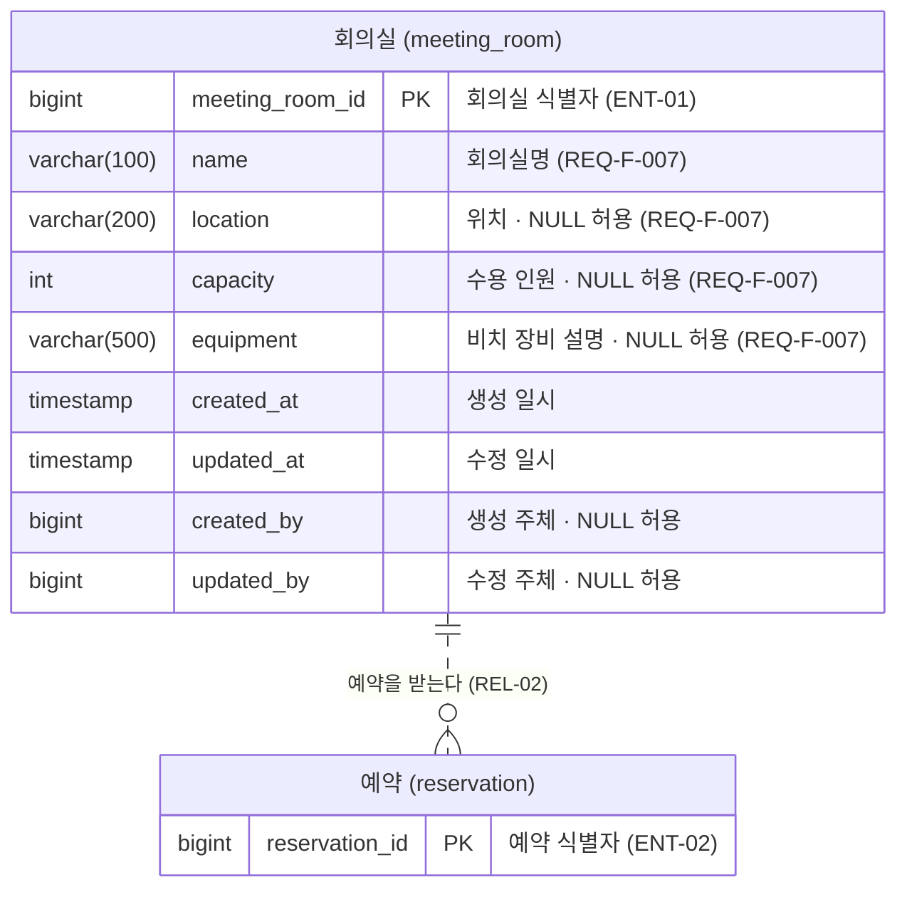

# 4-DN-14-O2 ERD-meeting-room

담당 도메인의 테이블·컬럼·제약조건 상세 ERD.
타 도메인 테이블을 FK로 참조하는 경우 해당 테이블도 표시하되 PK 컬럼만 포함한다.

---

## 1. 문서 정보

| 항목 | 내용 |
|------|------|
| 프로젝트명 | 회의실 예약 시스템 |
| 작성자 | 설동혁 (DA) |
| 작성일 | 2026-10-27 |
| 버전 | 1.0 |
| 도메인 | 회의실 (`domainId`: meeting-room) |
| 전략 | Code First — 코드 전 |
| 참조 | `4-DN-14-O1 ERD-overview.md`, `3-AN-05-O1 도메인 분석표.md`, `4-DN-12-O2` `entities.yaml` |

## 2. ERD

## 3. 표기 규칙

| 항목 | 규칙 |
|------|------|
| 엔티티명 | `물리명["논리명 (물리명)"]` 별칭 표기 — 다이어그램 헤더에 논리명·물리명을 함께 표시한다 |
| 데이터 타입 | 길이를 포함해 타입 필드에 직접 표기한다 (예: `varchar(50)`, `varchar(100)`) |
| decimal/numeric | Mermaid 구문 제약(타입 괄호 안 콤마·점 불가)으로 precision·scale을 하이픈으로 표기한다 — `decimal(18-2)` = `DECIMAL(18,2)` |
| 키 | `PK` / `FK` / `UK`. 복합인 경우 `PK, FK` 형식으로 병기한다 |
| 예약어와 겹치는 컬럼명 | 컬럼명이 `PK`·`FK`·`UK`이면(대소문자 무관) Mermaid가 파싱하지 못한다. **§2에서만** 뒤에 밑줄을 붙이고(`pk` → `pk_`) 설명 앞머리에 실제 물리명을 병기한다 — `int pk_ UK "품목표준용어 식별자 · 물리명 PK · ENT-03"`. **§5 스펙 표의 「컬럼명」은 실제 물리명 그대로 둔다.** 컬럼을 §2에서 빼지 않는다 |
| Null 여부 | 모든 컬럼은 NOT NULL을 기본으로 간주한다. NULL 허용 컬럼만 설명에 `NULL 허용`을 표기한다 |
| 관계명 | `"한글 관계명 (REL-ID)"` 형식. 한글 관계명은 `4-DN-11-O1 도메인 정의서 §4 관계`에서 가져오며 새로 짓지 않는다. 도메인 정의서 작성(`4-DN-11`) 생략 시 엔티티 명세서(`4-DN-12-O1`)의 `relations[].name_ko`를 쓴다. 이 값은 도메인 분석표(`3-AN-05-O1`)의 `관계명`을 계승한다. DB First로 엔티티 명세서 작성(`4-DN-12`)보다 앞서면 도메인 분석표를 직접 계승한다 |
| 관계선 | 담당 도메인 내부 관계는 실선(`\|\|--o{`), 타 도메인 참조 관계는 점선(`\|\|..o{`) |
| 타 도메인 테이블 | PK 컬럼만 표시한다 |
| 추적성 | 컬럼·관계 설명에 도메인 분석표 또는 도메인 정의서(4-DN-11)의 ENT- / REL- / BR- ID를 병기한다 (설계에서 신설된 엔티티·관계는 도메인 정의서 ID) |

> **[작성 안내]** **호환성**: 위 문법은 GitLab 16.x(Mermaid 10) 기준으로 검증되었다(0.7.22). 타입 괄호 안 콤마·점 금지, 번호 접두어 금지 등 렌더러 제약과 문법별 검증 상태는 다이어그램 표기 규약(9-CM-04, `get_common_guide("diagram")`)이 정본이다.

---

## 4. 테이블 요약

| 논리명 | 테이블명 | ENT-ID | 도메인 | 설명 |
|--------|---------|--------|--------|------|
| 회의실 | meeting_room | ENT-01 | 회의실 (담당) | 예약 대상 회의실 정보 |
| 예약 | reservation | ENT-02 | 예약 (참조) | FK 참조 테이블 — PK만 표시 |

## 5. 테이블 스펙

> **역할 구분** — §2 Mermaid ERD는 관계 **조감용**이고, 이 표가 이 문서 안에서 컬럼 스펙
> (DB 타입·NULL·키·변환 근거)의 정본이다. 둘이 어긋나면 이 표를 따르고 ERD를 고친다.
> 구현 스키마 전체의 SSOT는 `entities.yaml`(4-DN-12)이며, 이 표와 entities.yaml의 정합은
> 데이터 설계 흐름 백서 운영 원칙 6(엔티티 명세서·ERD 양방향 정합)을 따른다.

### meeting_room — 회의실

| 컬럼명 | Java 필드명 | 논리명 | 타입 | NULL | 키 | 참조 대상 | AS-IS 원컬럼 | 비고 |
|--------|------------|--------|------|:----:|:--:|----------|-------------|------|
| meeting_room_id | meetingRoomId | 회의실 식별자 | bigint | N | PK | — | — | ENT-01 |
| name | name | 회의실명 | varchar(100) | N | — | — | — | REQ-F-007 |
| location | location | 위치 | varchar(200) | Y | — | — | — | REQ-F-007 |
| capacity | capacity | 수용 인원 | int | Y | — | — | — | REQ-F-007 |
| equipment | equipment | 비치 장비 | varchar(500) | Y | — | — | — | REQ-F-007 |
| created_at | createdAt | 생성 일시 | timestamp | N | — | — | — | 공통(BaseEntity) |
| updated_at | updatedAt | 수정 일시 | timestamp | N | — | — | — | 공통(BaseEntity) |
| created_by | createdBy | 생성 주체 | bigint | Y | — | — | — | 공통(BaseEntity) |
| updated_by | updatedBy | 수정 주체 | bigint | Y | — | — | — | 공통(BaseEntity) |

## 6. 테이블 수준 제약·인덱스

해당 없음 — 단일 컬럼 PK 외에 테이블 수준 제약·인덱스가 없다.

## 7. 관계 요약

| REL-ID | 관계명 | 부모 논리명 | 부모 테이블 | 자식 논리명 | 자식 테이블 | FK 컬럼 | 카디널리티 | 설명 |
|--------|-------|-----------|------------|-----------|------------|---------|:----------:|------|
| REL-02 | 예약을 받는다 | 회의실 | meeting_room | 예약 | reservation | meeting_room_id | 1:N | 회의실 1곳은 여러 예약을 일시별로 받는다 (자식 테이블은 예약 도메인 소관) |

## 8. 변경 이력

| 버전 | 변경일 | 변경자 | 변경 내용 |
|------|--------|--------|---------|
| 1.0 | 2026-10-27 | 설동혁 (DA) | 최초 작성 |
