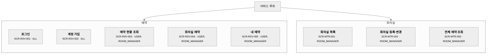

# 4-DN-31-O1 사이트맵

---

## 1. 문서 정보

| 항목 | 내용 |
|------|------|
| 프로젝트명 | 회의실 예약 시스템 |
| 작성자 | 설동혁 (PL) |
| 작성일 | 2026-10-27 |
| 버전 | 1.0.1 |
| screen_id 체계 | `SCR-{모듈코드}-{3자리 순번}` — `{모듈코드}`는 도메인 분석표(`3-AN-05-O1`) §2 영역코드(모듈이 도메인과 다르면 도메인 코드에 귀속) |
| 근거 문서 | `3-AN-08-O1 요구사항 정의서.md`, `3-AN-09-O1 업무프로세스 정의서.md`, 시스템 아키텍처 정의서(`4-DN-01-O1`) FE 토폴로지 ADR |
| 편입 | — |
| 비고 | 위임 결정: 요구사항 정의서가 사이트맵에 위임한 항목 없음 |

## 2. 계층 구조

> **[작성 안내]** **모듈 분리 기준** — `~~~` 체이닝으로 모듈 내부 폭은 잡히지만 **가로 폭은 모듈 수에 비례**한다.
> 모듈이 늘어 가로 스크롤이 생기면 `### 2.1 주문 관리`처럼 **같은 파일 안에** 하위 절을 두고
> 모듈별로 나눈다(파일을 쪼개지 않는다). 판단 기준은 화면 수가 아니라 실제 렌더링 폭이다.
> 모듈 예닐곱 개까지는 대개 분리 없이 담긴다.
>
> **화면 인벤토리의 정본은 §3 화면 목록 표다.** 다이어그램을 절로 나누더라도 §3 표는 전체 화면을
> 하나로 유지한다 — 이 표가 `screen_id`의 SSOT이자 게이트 판정 근거다. 둘이 어긋나면 §3을 따른다.
>
> 표기 문법(`subgraph` · `~~~` 체이닝 · 라벨 형식 · 렌더러 제약)은 다이어그램 표기 규약(9-CM-04)이
> 정본이다 — `get_common_guide("diagram")`. **라벨의 `<small>` 줄(screen_id · 권한)은 다이어그램 표기 규약(9-CM-04)
> 「줄당 20자 권장」의 예외다** — screen_id와 권한 코드를 함께 담으면 20자를 넘기는 것이 정상이다.
> 권한 코드가 셋 이상이면 대표 1개 + `+n`으로 접는다(예: `SCR-ORD-001 · ADMIN+2`).

---

## 3. 화면 목록

> 이 표가 `screen_id`의 SSOT이자 게이트 판정 근거다. `출처`는 `신규` / `재사용` / `편입: <라우트>` 중 하나이며 모든 프로젝트에서 채운다 — `[NuriAF·FE가 nuriaf7-react]`만 시스템 관리 화면을 `재사용`으로 적고(`4-DN-01-O1` FE 토폴로지 ADR 근거), `[고도화]`·`[유지보수]`에서 기존 시스템 편입(`1-PN-02`)이 라우트에서 역추출한 기존 화면은 `편입: <라우트>`이며, 그 밖에는 전부 `신규`다. 프로그램 목록 작성(`4-DN-21`)·Frontend 코드 구현(`5-IM-14`)이 이 열로 구현 범위를 가른다(품질 게이트 dn-31.P5). `비고`에는 다중 진입 경로·`(Mobile)` 전용 화면 같은 표기를 적는다.

| screen_id | 화면명 | 모듈 | 접근 권한 | 출처 | 근거 REQ-ID | 비고 |
|-----------|--------|------|-----------|------|-------------|------|
| SCR-RSV-001 | 로그인 | 예약 | ALL | 신규 | REQ-F-001, REQ-NF-001 | 미로그인 요청의 이동 대상 |
| SCR-RSV-002 | 계정 가입 | 예약 | ALL | 신규 | REQ-F-001 | 로그인 화면에서 진입 |
| SCR-RSV-003 | 예약 현황 조회 | 예약 | USER, ROOM_MANAGER | 신규 | REQ-F-002, REQ-NF-001 | 회의 제목은 예약자·관리 담당자에게만 표시 |
| SCR-RSV-004 | 회의실 예약 | 예약 | USER, ROOM_MANAGER | 신규 | REQ-F-003, REQ-F-004 | 예약 현황 조회 화면에서 진입. 겹침 거부 안내 포함 |
| SCR-RSV-005 | 내 예약 | 예약 | USER, ROOM_MANAGER | 신규 | REQ-F-005 | 시작 전 본인 예약 취소 |
| SCR-MTR-001 | 회의실 목록 | 회의실 | ROOM_MANAGER | 신규 | REQ-F-007 | — |
| SCR-MTR-002 | 회의실 등록·변경 | 회의실 | ROOM_MANAGER | 신규 | REQ-F-007 | 회의실 목록에서 진입 |
| SCR-MTR-003 | 전체 예약 조회 | 회의실 | ROOM_MANAGER | 신규 | REQ-F-006, REQ-F-008 | 회의실·기간별 조회. 다른 사람 예약 취소(시작 전) 포함 |

**접근 권한 코드**

> 역할 코드의 정본이다. 위 표와 UI&UX 제약사항(`4-DN-36-O1`, 제약사항)·코드 정의서(`4-DN-21-O2`, 코드 정의서)·Backend 초안(`5-IM-21-O1`, Backend 초안 권한 표)이 이 코드만 쓴다 — `ROLE_` 접두어 같은 다른 표기를 만들지 않는다(품질 게이트 dn-31.P4·dn-36.P8). 권한이 미확정인 화면은 `TBD`로 두되 승인 전에 채운다.

| 코드 | 역할 | 설명 |
|------|------|------|
| USER | 예약자(일반 직원) | 로그인 후 예약 현황 조회·예약·내 예약 취소. `Reserver.role` 기본값 |
| ROOM_MANAGER | 회의실 관리 담당자 | 일반 직원 기능에 더해 회의실 관리·전체 예약 조회·다른 사람 예약 취소. `Reserver.role` 값 |
| ALL | 인증 불필요 | 로그인 없이 접근(로그인·가입 화면) |

**앱 셸 요구사항**

> 화면 트리거는 있으나 특정 화면에 속하지 않는 전 화면 공통 요구사항(코치마크·상단 알림 배지·역할별 메뉴 분기 등)을 적는다.
> 위 화면 행에 붙이지 않는다 — 소유는 프로그램 목록(`4-DN-21-O1`)의 공통 프로그램이며, 번호는 그 활동이 매긴다(품질 게이트 dn-31.P1). 없으면 「없음」.

없음

---

## 4. 화면 없는 요구사항

> 사용자 화면 트리거 없이 배치·시스템 트리거로만 동작하는 기능 요구사항을 기록한다. 외부 시스템(홈페이지 등)이
> 우리 API를 호출해 동작하는 요구사항도 여기 둔다 — `트리거`에 호출하는 시스템을 적는다.
> `3-AN-09-O1 업무프로세스 정의서`의 `트리거` 컬럼이 배치·시스템으로 확정된 항목만 여기 둘 수 있다.
> 판단 근거 없이 옮기지 않는다 — 화면이 필요한데 누락한 것과 구분되지 않는다.
> 화면 사건과 같은 트랜잭션에서 시스템이 수행하는 상태 전이(등록 시 상태 값 자동 전환 등)는
> 화면 요구사항에 속하며 이 표의 대상이 아니다 — 그 화면의 §3 행에 남는다.
> 화면 트리거와 배치 트리거가 함께 있는 혼합 요구사항은 배치 부분만 이 표에 「배치 부분만」으로
> 적는다 — 화면 부분은 §3에 그대로 남긴다.
>
> 여기 기록된 요구사항은 `4-DN-21 프로그램 목록`에서 배치 프로그램 또는 연계 서비스로 구현 범위에 편입된다.
> 이 표는 "화면이 없다"는 사실의 기록이지 추적의 종점이 아니다. 없으면 "없음"으로 기록한다.

| REQ-ID | 요구사항명 | 근거 프로세스(PROC-ID) | 트리거 | 비고 |
|--------|-----------|----------------------|--------|------|
| — | (없음) | — | — | 모든 기능 요구사항의 `PROC-` 트리거가 사용자 요청이라 화면이 필요하다 |

---

## 5. 외부 산출물 링크

> 와이어프레임 작성(4-DN-32, 와이어프레임)·디자인 컨셉 정의(4-DN-33, 디자인 컨셉)·전체 화면 시안 작성(4-DN-38, 전체 화면 시안)이 이 자리에 파일 URL/경로를 기록한다.
> 디자이너가 참여하면(`options.designer_provided: true`) **Figma 파일 URL과 프레임 ↔ screen_id 매핑 표**도 여기 기록한다(`4-DN-00` 「디자이너 참여 시」).

| 산출물 | 유형 | URL / 경로 | 기록 단계 |
|--------|------|-----------|----------|
| 와이어프레임 명세 | **저장소 상대 경로 (필수)** — `4-DN-32-O1 와이어프레임 명세.md` | `docs/4-DN-32-O1 와이어프레임 명세.md` | 4-DN-32 |
| 디자이너 Figma | 파일 URL + 프레임 매핑 (디자이너 참여 시) | — (디자이너 미참여) | 4-DN-33 |
| 전체 화면 시안 | **저장소 경로 (필수)** | `frontend/src/app/(auth)/**`, `frontend/src/app/(app)/**` | 4-DN-38 |
| 디자인 시스템 | **저장소 경로 (필수)** — 토큰·공용 컴포넌트 | `frontend/src/app/globals.css`, `frontend/src/components/**` | 4-DN-38 |

> **「전체 화면 시안」·「디자인 시스템」 행은 반드시 저장소 경로여야 한다.** 전체 화면 코드베이스 통합(`5-IM-11`)이
> 이 경로의 코드를 이어받아 통합하기 때문이다. URL을 적으면 형식상 틀리지
> 않지만 자동 점검이 통째로 무력화된다. 와이어프레임 명세도 하류 세 곳이 파일로 Read하므로
> 같은 이유로 경로여야 한다.

> **디자이너 참여 시 수령 지점** — 디자이너가 방법론 밖에서 Figma로 작업하는 경우, 위 표에 URL을 기록하고 아래 **프레임 ↔ `screen_id` 매핑 표**와 **범위 합의** 한 줄을 채운다(`4-DN-33` 수행 절차 2, 품질 게이트 dn-33.P5). 링크만 기록하면 실현 원칙 9(External Artifact Integration)의 편입 조건을 충족하지 못한다. 지위 값·대조 결과 처리는 워크플로 가이드(`4-DN-00`) 「디자이너 참여 시」 절이 정본이다. 디자이너가 없으면 이 두 표를 `— (디자이너 미참여)` 한 줄로 둔다.

**프레임 ↔ screen_id 매핑 표** (`options.designer_provided: true`)

— (디자이너 미참여)

**범위 합의**: — (디자이너 미참여)

## 6. 변경 이력

| 버전 | 변경일 | 변경자 | 변경 내용 |
|------|--------|--------|---------|
| 1.0 | 2026-10-27 | 설동혁 (PL) | 최초 작성. 요구사항 정의서·업무프로세스 정의서에서 화면 8개 도출, 역할 코드는 `Reserver.role` 값(USER, ROOM_MANAGER)과 ALL |
| 1.0.1 | 2026-10-27 | 설동혁 (PL) | 정정 — §5 와이어프레임 명세 행에 저장소 경로 기록(4-DN-32 절차 7) |
| 1.0.2 | 2026-10-27 | 설동혁 (PL) | 정정 — §5 전체 화면 시안·디자인 시스템 행에 저장소 경로 기록(4-DN-38 절차 7) |
